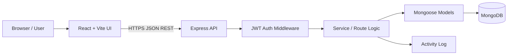
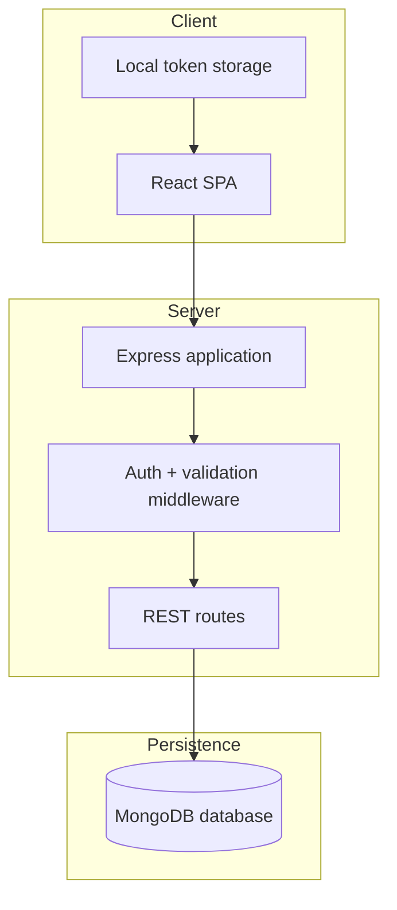
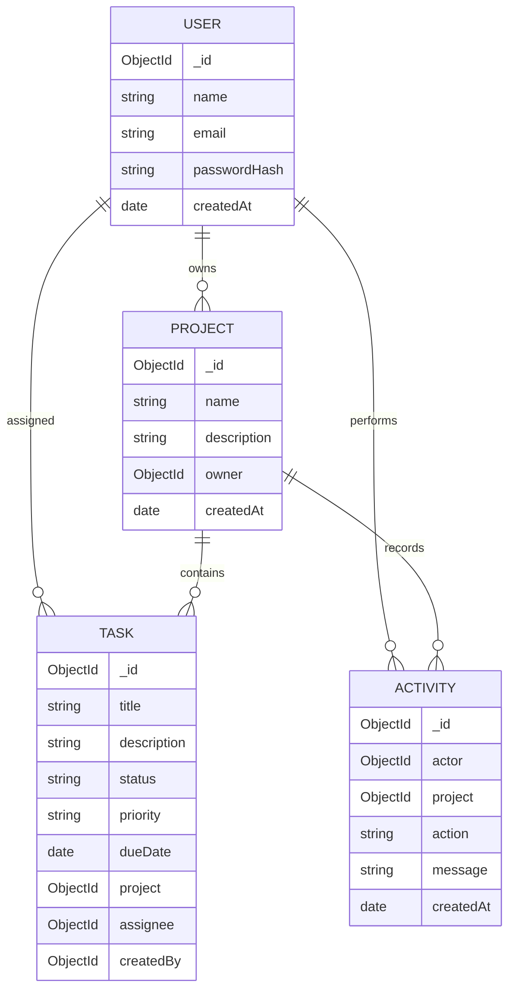

# System Architecture & Data Model

## 1. High-level architecture

## 2. Deployment view

## 3. Entity relationship diagram

## 4. MongoDB collections

- `users`: account identity and password hash.
- `projects`: project metadata and owner reference.
- `tasks`: task details, workflow state, priority, due date and references.
- `activities`: user action feed.

## 5. State management tree

See `STATE_TREE.md` for the frontend state tree and ownership rules.

## 6. Security boundaries

- Passwords hashed with bcrypt.
- JWT checked on protected routes.
- User identity comes from verified token, not request body.
- Project/task access is scoped to the authenticated user.
- Environment variables hold database URI and JWT secret.
- Production hardening: rate limiting, Helmet, strict CORS, schema validation, audit logs and security tests.
